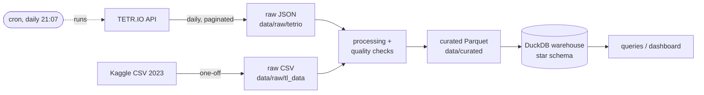

# TETR.IO Player Progression Analytics

Data Engineering (34623) – Universidad San Jorge – Semester Project

## Overview

A daily data pipeline that snapshots the complete TETR.IO Tetra League leaderboard, integrates it with a historical snapshot of the same players (September 2023), and loads the result into a data warehouse to analyse how players progress over time and which playstyle metrics distinguish the rank tiers.

The TETR.IO API only exposes the *current* state of each player, so the daily snapshots are the only way to build this history.

## Team

| Member | Role |
|---|---|
| Eduardo Lázaro Esperón | Platform & Cloud Lead |
| Hermes Benito Andrés | Orchestration & Quality Lead |
| Mariano Latre López | Delivery & Presentation Lead |
| All members (shared) | Ingestion & Storage |

Roles define ownership of tasks only; every member can explain the whole project.

## Datasets

| # | Dataset | Source | Update | Join key |
|---|---|---|---|---|
| D1 | Tetra League leaderboard | [TETR.IO public API](https://tetr.io/about/api/) | Daily snapshot | `_id` |
| D2 | TETR.IO Player data (Sep 2023) | [Kaggle](https://www.kaggle.com/datasets/inferno2332/tl-data) | Static, one-off load | `id` |

A third dataset (Kaggle "Tetr.io Top Players Replays") was evaluated and discarded: it has no player identifier and only covers the top rank tier. See `docs/checkpoints/`.

## Pipeline



| Stage | Code | Output |
|---|---|---|
| Ingestion | `src/ingestion/` | `data/raw/` |
| Processing + quality | `src/transformation/transform.py`, `src/quality/checks.py` | – |
| Integration | `src/transformation/integrate.py` | `data/curated/*.parquet` |
| Load (star schema) | `src/load/warehouse.py`, `warehouse/*.sql` | `data/warehouse/tetrio.duckdb` |
| Logging | `src/monitoring/logger.py` | `logs/pipeline.log` |
| Scheduling | `orchestration/crontab.txt` | – |

Data, logs and secrets are not committed (see `.gitignore`); the pipeline recreates the data.

## Setup

Requires **Python 3.12**.

```bash
python3.12 -m venv .venv
source .venv/bin/activate
pip install -r requirements.txt
cp .env.example .env
```

Then open `.env` and set `KAGGLE_API_TOKEN` (kaggle.com → Settings → API). Never commit `.env`.

## Run

```bash
python -m src.pipeline                  # full run: fetches today's snapshot (~7 min)
python -m src.pipeline --skip-fetch     # rebuild from existing raw files (seconds)
pytest                                  # unit tests
python -m notebooks.explore_warehouse   # example analytical queries
```

## Documentation

| Document | Content |
|---|---|
| [`docs/orchestration.md`](docs/orchestration.md) | Daily schedule, options compared, migration plan |
| `docs/architecture.md` | Lifecycle mapping, architecture and cluster design |
| `docs/monitoring.md` | Logging and alerting design |
| [`docs/checkpoints/`](docs/checkpoints/) | Checkpoint status updates |
| [`docs/ai_usage_disclosure.md`](docs/ai_usage_disclosure.md) | How AI was used to build this project |
