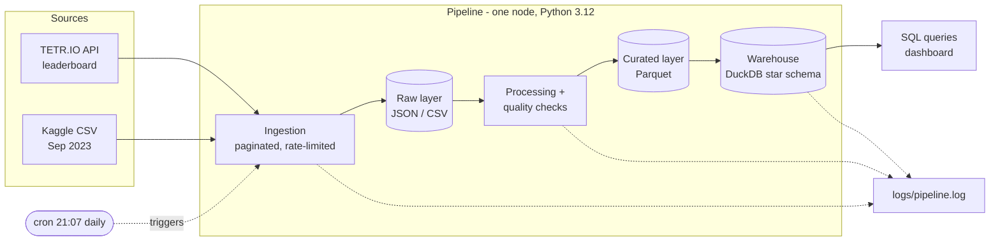

# Architecture and Data Lifecycle

How data flows through the TETR.IO pipeline, which component handles each stage of the data lifecycle, and why the solution runs on a single node today.

## 1. Data lifecycle mapping

The course defines six stages: Generation → Ingestion → Storage → Processing → Analysis → Archival/Deletion. Each stage has an explicit process in this project:

| Stage | What happens in this project | Code / location | Frequency |
|---|---|---|---|
| **1. Generation** | TETR.IO's game servers produce each player's Tetra League statistics (TR, rank, APM, PPS, VS…). The 2023 baseline was produced once by the author of the Kaggle dataset. | External (TETR.IO, Kaggle) | Continuous / once |
| **2. Ingestion** | Paginated download of the complete leaderboard (100 players per page, 1 request/s, retries on HTTP 429/5xx). One-off download of the 2023 CSV through the Kaggle CLI. Data minimisation: only ID, username, country and league statistics are kept. | `src/ingestion/tetrio_api.py`, `src/ingestion/kaggle_loader.py` | Daily / once |
| **3. Storage** | Three layers: **raw** (one JSON file per day, unchanged API output), **curated** (cleaned and integrated Parquet tables), **warehouse** (star schema in DuckDB). | `data/raw/`, `data/curated/`, `data/warehouse/` | Daily |
| **4. Processing** | Flattening of the nested JSON, common schema for both sources, sentinel values (`-1`) to null, types and text normalisation, quality checks (no ID, duplicates, invalid TR), join of 2023 and today on `player_id`, SCD type 2 for players, load into the star schema. | `src/transformation/`, `src/quality/`, `src/load/`, `warehouse/*.sql` | Daily |
| **5. Analysis** | SQL queries on the star schema (rank distribution, TR progression, playstyle per rank); daily sanity check; dashboard planned. | `warehouse/queries.sql`, `notebooks/explore_warehouse.py`, `notebooks/check_daily.py` | On demand / daily |
| **6. Archival / Deletion** | Retention policy and deletion process (Section 1.2). | Policy (see below) | Periodic |

### 1.1 Pattern: ETL with a raw landing layer

Raw data is **stored first, unchanged**, then transformed, and only the transformed result is loaded into the warehouse. The warehouse therefore never receives untransformed data (ETL), while the raw layer keeps the original API output so any day can be reprocessed if a transformation bug is found. This matters because the API keeps no history: the raw files are the only copy of each day.

### 1.2 Archival and deletion policy

| Data | Retention | Reason |
|---|---|---|
| Raw daily JSON (~11.6 MB/day) | Kept for the whole project; after 90 days, compressed (gzip) and moved to cold storage once the cloud migration is done | Only copy of each day; needed to rebuild the curated layer |
| 2023 Kaggle CSV | Kept (static, 6.3 MB) | Baseline of the progression analysis |
| Curated Parquet and DuckDB warehouse | Not archived: rebuilt from raw on every run | Derived data; full refresh makes it reproducible |
| Logs | 30 days | Enough to investigate incidents |

**Deletion on request (GDPR).** Usernames, countries and activity over time are personal data. To delete one player:

1. Remove the player's records from every raw JSON file (and from the 2023 CSV).
2. Run the pipeline: because the curated layer and the warehouse are rebuilt from raw on every run, the player disappears from all downstream tables automatically.

Status: the retention policy and the deletion process are **defined but not automated yet**; log rotation and raw compression are planned with the cloud migration.

## 2. Architecture

| Component | Technology | Why |
|---|---|---|
| Language | Python 3.12 | Course requirement; pandas, requests and DuckDB clients available |
| Raw storage | JSON files | Keeps the exact API response; simple to reprocess |
| Curated storage | Parquet | Columnar, compressed, typed; read directly by DuckDB and BigQuery |
| Warehouse | DuckDB | See Section 4 |
| Scheduling | cron (interim) → GitHub Actions | See `docs/orchestration.md` |
| Monitoring | Python logging to file | See `docs/monitoring.md` |

### Current volumes (measured)

| Measure | Value |
|---|---|
| Players per daily snapshot | ~36,000 |
| API pages per run | ~360 |
| Run time | ~450 s (ingestion ~99%, processing and load ~2 s) |
| Raw size per day | ~11.6 MB |
| Growth per year | ~13 million fact rows, ~4.2 GB of raw JSON |

## 3. Cluster design

**Decision: a single node is enough today.**

- **The bottleneck is the API, not computation.** About 99% of the run is spent waiting between API requests (rate limit of about 1 request/s). Adding machines would not make ingestion faster: the API usage rules ask for about one request per second, so spreading requests over several machines would break the rules rather than speed up a compliant pipeline. It would only add cost and complexity.
- **Processing is tiny.** Cleaning, integrating and loading ~117,000 rows takes about 2 seconds and fits easily in memory.
- **A cluster has a cost.** Distributed processing (e.g. a Spark cluster) adds infrastructure to operate, network transfer between nodes and always-on resources, with no benefit at this volume.

**When this stops being true** (detailed in the scalability analysis):

| Growth | First problem | Direction |
|---|---|---|
| Months of daily snapshots | Full refresh reprocesses all history every day | Incremental loads (process only the new day) |
| ×10 rows | Sequential ingestion would take over an hour | Parallel requests, if the API allows them |
| ×1,000 and beyond | Data no longer fits in one machine's memory; DuckDB file grows to hundreds of GB | Serverless cloud warehouse (BigQuery) that scales automatically, or distributed processing (Spark) |

The preferred path is **scaling up, then serverless**, rather than running our own cluster: a managed warehouse distributes the work internally without the team operating nodes.

## 4. Warehouse choice

| Criterion | DuckDB (now) | BigQuery (planned) | PostgreSQL |
|---|---|---|---|
| Cost | Free | Free tier, then pay per data stored and scanned | Free software, but needs a running server |
| Setup / operation | `pip install`, one file | GCP project, IAM, credentials | Server or container to maintain |
| Analytical performance | Columnar, fast on one machine | Columnar, distributed, scales automatically | Row-based: better for transactions than analytics |
| Sharing / dashboard | Local file, one user | Native connection to Looker Studio | Possible, needs network access |
| Lock-in | None | Google Cloud | None |
| Environmental footprint | No idle server | Shared infrastructure, no idle cost for us | Always-on server |

**Decision:** DuckDB for development now; BigQuery for the cloud version (cloud services via the Python SDK, Looker Studio dashboard). The SQL is kept in separate files (`warehouse/*.sql`) to make the port easier. Pricing and free-tier limits change: check Google's current documentation before relying on them.

## 5. Environmental impact

- **Batch once a day:** the lowest frequency that still captures every daily snapshot. More frequent runs would multiply API calls and energy use without adding information.
- **No always-on infrastructure:** the pipeline uses compute only while it runs (~7 minutes, mostly waiting); the planned cloud setup (GitHub Actions + serverless warehouse) keeps this property.
- **Storage growth is the main long-term cost:** ~4.2 GB of raw JSON per year. Compressing raw files and moving old ones to cold storage reduces both cost and footprint.
- **Data minimisation also reduces footprint:** fields that are not needed are never stored.
- **Cloud region:** when migrating, a region with a high share of carbon-free energy will be preferred (check the provider's published figures per region).
